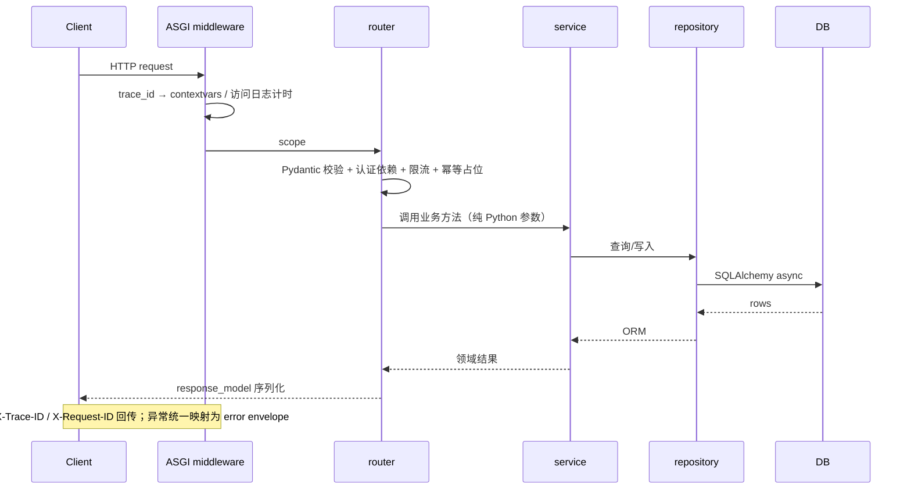
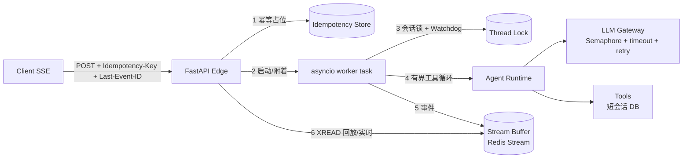
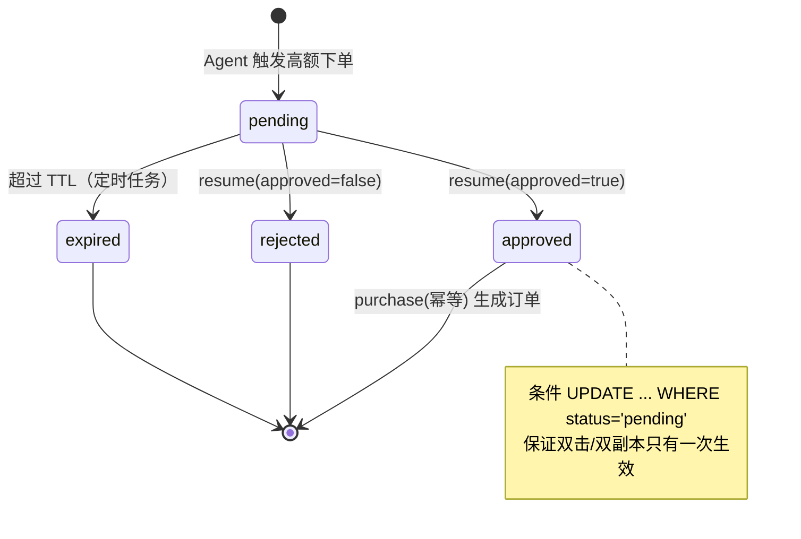

# 架构说明与 PDF 对照

本文回答三个问题：**为什么这样分层**、**PDF 里的每个建议落在哪**、**还差什么**。

> 参考材料：《FastAPI 工业级后端架构与落地建议》（用户提供的 16 页 PDF，2026-11-13）。
> 本文中的"PDF §x"指该文档的章节/主题，不指页码。

---

## 1. 目标与约束

| 目标 | 约束 / 现实 |
| --- | --- |
| 模块化单体起步，未来可拆服务 | 单仓库、单镜像；不引入服务注册/网关 |
| 全链路异步（FastAPI + SQLAlchemy 2.0 async） | 部分能力（CN-CLIP、Playwright）只有同步/线程实现 |
| 强类型契约（Pydantic v2） | 无 `dict[str, Any]` 满天飞；写接口 `extra="forbid"` |
| 可观测（结构化日志 + trace_id） | 部署环境无法安装 `structlog`/OTel，用 stdlib JSON formatter 等价实现 |
| 可降级（Redis/LLM/视觉任一缺失仍可服务） | 每个外部依赖都有 in-memory 或 503 的降级路径 |
| 可部署（迁移与启动解耦、优雅停机、探针） | 见 `docker-compose.yml`、`Dockerfile`、`docs/RUNBOOK.md` |

---

## 2. 分层与依赖规则

```text
api/           路由总装（唯一知道全部 URL 的地方）
modules/<域>/  router → service → repository → models
                ↑            ↑
              schemas      shared gateways (LLM/Embedding/Feishu/Storage)
core/          配置、DB、Redis、日志、异常、中间件、任务、幂等、限流
shared/        认证依赖、跨模块 DTO、embedding 客户端
container.py   组合根（进程级单例在这里创建/注入/关闭）
```

硬规则（评审时按此卡）：

1. `core/*` **不得** import `modules/*`；`modules/*` 不得互相 import 对方的 `models`；
2. `router.py` 只做：参数校验 → 调用 service → 组织响应，单函数 < 20 行；
3. `service.py` 不 import `fastapi`（不抛 `HTTPException`）、不拼 SQL；
4. `repository.py` 只做数据访问，返回 ORM 对象，不提交事务（除显式查询型写入）；
5. 外部 HTTP 调用必须走 `shared/` 网关，带显式 timeout、信号量与有限重试；
6. 任何进程级资源都只能在 `container.py` 创建。

> 自查命令（近似门禁）：
> `grep -rn "from fastapi" src/app/modules/*/service.py` 应为空；
> `grep -rn "HTTPException" src/app/modules | grep -v router` 应为空。

---

## 3. 请求生命周期



关键点：

- **会话生命周期**：`get_db_session` 在每个请求结束时关闭 session；SSE 路由**不注入** session，
  后台 worker 自己开短会话（PDF §"法则 1"）。
- **错误映射**：`AppError` 子类带 `code/status_code`，`register_exception_handlers` 统一输出
  `{"error": {...}, "detail": ...}`，兼容旧客户端的 `detail` 字段。
- **trace 贯穿**：`contextvars` 中的 `trace_id` 被 JSON 日志、错误体、`X-Trace-ID` 响应头
  以及异步任务（`restored_context`）共用，跨线程/任务不丢失。

---

## 4. 六大铁律的落地与证据

### 4.1 铁律一：严防 Event Loop 阻塞

| 风险点 | 处理 | 位置 |
| --- | --- | --- |
| LLM 调用 | `httpx.AsyncClient` 流式读取，不再用同步 `zhipuai`/`openai` SDK | `chat/llm_gateway.py` |
| Embedding | 异步 HTTP + 两级缓存 + 信号量 | `shared/embeddings.py` |
| 视觉推理（CPU 重） | `asyncio.to_thread` + 线程锁懒加载 + 超时 | `items/vision.py` |
| 磁盘写文件 | `asyncio.to_thread` | `items/storage.py` |
| 爬虫 | 原生 async Playwright，懒 import，超时兜底 | `chat/scraper.py` |
| DB | 全部 `AsyncSession`；`expire_on_commit=False`；显式 `selectinload` | `core/database.py`、各 repository |
| 同步 Redis 客户端 | 统一 `redis.asyncio`，连接池 + socket timeout | `core/redis.py` |

自查：`grep -rnE "time\.sleep|requests\.|psycopg2|\.execute\(" src/app` 只应出现在同步适配器/注释中。

### 4.2 铁律二：拒绝 BaseHTTPMiddleware

`core/middleware.py` 的四个中间件全部实现 `__call__(scope, receive, send)`：

- `RequestContextMiddleware`：入站 `X-Trace-ID` 校验（正则限制长度/字符）→ contextvars → 响应头；
- `AccessLogMiddleware`：包裹 `send` 统计状态码、耗时、响应字节数，流式响应在最后一帧记一次；
- `SecurityHeadersMiddleware`：nosniff / DENY / referrer / HSTS（可选）；
- `BodySizeLimitMiddleware`：先看 `Content-Length`，再对 chunked 流累加计数，超限 413。

顺序（外→内）：RequestContext → AccessLog → SecurityHeaders → BodySizeLimit → CORS。
鉴权**不在**中间件里，而是 `Depends(get_current_user)`（PDF 明确要求）。

### 4.3 铁律三：Schema 与 ORM 严格分离

- 每个模块 `models.py`（SQLAlchemy 2.0 `Mapped[...]`）与 `schemas.py`（Pydantic DTO）分离；
- 响应模型不含 `embedding`/`hashed_password`；`ItemRead` 从结构上杜绝向量泄漏；
- `async_sessionmaker(expire_on_commit=False)`；关联查询用 `selectinload`，避免 `MissingGreenlet`；
- 写接口 `extra="forbid"`：字段拼写错误立刻 422，而不是被静默忽略。

### 4.4 铁律四：lifespan 统一管控资源

`main.create_app()` 的 lifespan：

```text
启动：configure_logging → import models/tasks → 建 container
      → Redis connect（失败仅降级）→ 构建幂等/限流/队列/流缓冲/锁/Agent/飞书
      → 启动审批清理循环 → DB ping（失败只告警，readiness 报 503）
停机：取消清理循环 → 等待/取消在跑的 Agent 任务 → drain 任务队列
      → 关闭 httpx → 关闭 Redis → dispose DB
```

顺序保证"不会在协程运行中关闭它依赖的资源"。`stop_grace_period: 30s`（compose）与
K8s `terminationGracePeriodSeconds: 60` 配合（见 RUNBOOK）。

### 4.5 铁律五：统一领域异常 + 防重幂等

- 异常层次：`AppError → ValidationError / NotFoundError / ConflictError / PermissionDeniedError /
  UnauthorizedError / RateLimitedError / OutOfStockError / ApprovalRequiredError ...`
- 幂等两阶段（Redis 或内存实现）：
  `begin()`：`SET NX EX` 占位 → `STARTED | IN_PROGRESS | REPLAY | MISMATCH`；
  `remember()`：完成时写回状态码与响应体；`release()`：失败时释放以便重试；
  同一 key 不同请求体 → `409`（客户端 bug）。
- 审计：`orders.idempotency_key` 唯一索引，即使多副本同时通过 Redis 校验也不会重复下单。

### 4.6 铁律六：迁移与容器启动解耦

- `Dockerfile` 的 `CMD` 只有 uvicorn；没有 `alembic upgrade`;
- `docker-compose.yml` 用一次性 `migrate` 服务 + `service_completed_successfully` 依赖；
- CI 有独立 `migrations` job（upgrade → downgrade，验证可回滚）；
- `alembic/env.py` 从 `Settings` 取 URL、`compare_type=True`、SQLite 下 `render_as_batch=True`。

---

## 5. Agent / SSE 架构

### 5.1 拓扑



### 5.2 三层背压

1. **会话级互斥**：`ThreadLockManager.hold(thread_id, run_id)`，Redis `SET NX EX` + 后台 watchdog
   每 `TTL/3` 续期，释放用 Lua compare-and-delete（防误删他人锁）；进程崩溃后 TTL 自动过期。
2. **用户级配额**：`rate_limit("chat", limit=20, window_seconds=60)`，按 `user_id`（未登录按 IP）。
3. **上游并发**：`LLMGateway` 内 `asyncio.Semaphore(LLM_MAX_CONCURRENCY)`；429/5xx 指数退避，
   但**仅在尚未输出 token 时**重试，避免半截流重复。

### 5.3 幂等状态机（SSE）

```text
             ┌────────── 首次 ──────────┐
             │                          ▼
  key 不存在 │                   STARTED(占位)
             │                          │ worker 完成
  重试 ──────┼─► IN_PROGRESS ──► COMPLETED(回放响应体)
             │      (409)               │
             └── 不同消息 ─► MISMATCH(409)
```

- `STARTED`：持久化用户消息 → 起后台任务 → 返回 SSE；
- `IN_PROGRESS`：不重复调用 LLM，直接附着到同一 buffer（`Last-Event-ID` 补齐）；
- `COMPLETED`：buffer 仍在 → 回放事件；buffer 过期 → 用保存的摘要发一个 `done` 帧。

### 5.4 断线处理

`AGENT_DISCONNECT_POLICY`：

| 值 | 行为 | 适用 |
| --- | --- | --- |
| `continue`（默认） | SSE 生成器退出，后台继续跑完当前轮并落库 | 有写操作/状态流转的会话 |
| `abort` | 置 `cancel_event`，运行时在下一次检查点退出并中止上游流 | 纯闲聊，省 token |

实现细节：断线检测 = `request.is_disconnected()`；生成器返回即停止写响应，但**不取消** worker；
worker 的 `cancel_event` 才是唯一的中止信号，因此不会出现"HTTP 断开导致事务只写一半"。

### 5.5 事件缓冲与可替换实现

`StreamBuffer` 协议：`append / read(after_id, block_ms) / clear`。

- `RedisStreamBuffer`：`XADD MAXLEN ~ 2000` + `EXPIRE TTL`，`XREAD BLOCK` 实现实时；
  事件 id 天然支持 `Last-Event-ID`；多副本共享。
- `InMemoryStreamBuffer`：`asyncio.Condition` 阻塞读、有界裁剪、TTL 清理；用于测试与无 Redis 部署。

选择在启动时根据 Redis 可用性完成（`active_client`），运行期不切换。

### 5.6 Agent 运行时

`NativeAgentRuntime` 是显式状态机：

```text
for step in 1..AGENT_MAX_STEPS:
    llm_stream(tools) → 逐 token 产出
    无 tool_calls → done
    有 tool_calls → 逐个执行（每个工具自己开短会话）
        ApprovalRequired → 落库 + interrupt_required + done
        AppError/异常    → 结构化错误文本回喂模型（不崩循环）
```

- 工具参数由 JSON Schema 约束；模型乱传参数返回 `{"status":"error"}` 而不是 500；
- 工具输出截断到 1600 字符（控制上下文与费用）；
- 每次工具调用生成确定性幂等键 `tool:{thread_id}:{tool_call_id}`，重试不会重复下单。

`AGENT_RUNTIME=langgraph` 会启用真正的 LangGraph 状态机（checkpointer + `interrupt()` +
`Command(resume=...)`），详见 §6.4；默认 `native` 不引入额外依赖。

> 边界说明（0.2.1）：`chat/service.py` 不 import FastAPI。它返回与传输无关的
> `ChatRun(events: AsyncIterator[str], headers, media_type)`，断线探测以
> `Callable[[], Awaitable[bool]]` 注入；`StreamingResponse` 与 `Request.is_disconnected`
> 只存在于 `chat/router.py`。

---

## 6. 交易与 HITL

### 6.1 下单（防超卖）

```text
purchase()
  ├─ 幂等键已存在？→ 返回原订单（replay）
  ├─ 求购贴/自购 → 400
  ├─ 金额 ≥ 阈值 且 require_approval → ApprovalRequired（不扣库存）
  ├─ UPDATE item SET inventory = inventory - n, is_sold = (inventory - n <= 0)
  │        WHERE id = ? AND inventory >= n        -- 原子、对 PG/SQLite 都正确
  ├─ INSERT orders(price snapshot, quantity, address, idempotency_key UNIQUE)
  └─ enqueue notifications.order_alert
```

为什么不用 `SELECT ... FOR UPDATE`：SQLite 忽略行锁；条件 UPDATE 在任何方言下都是原子的，
且少一次往返。唯一索引在"多副本同时通过 Redis 幂等"时兜底，冲突则回滚、返回已有订单。

### 6.2 HITL 状态机



- 决策抢占：`UPDATE agent_approvals SET status=? WHERE id=? AND status='pending'`，`rowcount==1` 才算赢；
- 执行幂等：下单键 `approval:{id}`，重复 resume 不会二次扣库存；
- 审批过期：`chat/tasks.expire_approvals`（API 进程内的定时循环 + 可被 worker 任务调用），
  避免"永不审批"的会话永久半挂起；
- 前端刷新后可通过 `GET /threads/{id}/status` 重新渲染审批卡片（PDF 的要求）。

### 6.3 State 载荷瘦身

- 落库的助手消息截断 8000 字符；工具输出截断 1600 字符；
- 上下文窗口固定 `AGENT_CONTEXT_MESSAGES`（默认 8），不把整段 RAG 原文塞进历史；
- SSE buffer `MAXLEN ~ 2000` + TTL 600s，不会无限增长。

### 6.4 两套 Agent 运行时：native 与 LangGraph

项目现在**同时提供**两种运行时，通过 `AGENT_RUNTIME` 选择，接口一致（`AgentRuntime` 协议：
`run(...) -> AsyncIterator[AgentEvent]`），SSE/审批/历史/飞书复用同一套外层逻辑：

| 能力 | `native`（默认） | `langgraph`（可选 extra） |
| --- | --- | --- |
| 工具循环 | 自研有界循环（`AGENT_MAX_STEPS`） | LangGraph `StateGraph` + 条件边 |
| 持久化 | 业务库 `ai_chat_records` | `AsyncPostgresSaver`（独立 psycopg 池）/ `InMemorySaver` |
| 动态挂起 | `ApprovalRequiredError` → 审批表 → `interrupt_required` 事件 | 同样的审批表 + LangGraph `interrupt()` |
| 恢复 | `resume` 只落审批结果 | `Command(resume=...)` 继续图，模型接着说话 |
| 依赖 | 无额外依赖 | `langgraph` + `langgraph-checkpoint-postgres`（`pip install -r requirements-langgraph.txt`） |

实现要点（`chat/runtime_langgraph.py`、`chat/checkpointer.py`）：

- **双池物理隔离**：checkpointer 使用独立 `AsyncConnectionPool`（`autocommit=True`,
  `row_factory=dict_row`, `prepare_threshold=0`），与 SQLAlchemy 业务池完全分离；
  `POSTGRES_RAW_DSN` 使用 psycopg3 的 `postgresql://`（不能带 `+asyncpg`）。
- **业务事实来源仍是审批表**：节点捕获 `ApprovalRequiredError` 后幂等落库并 `interrupt()`；
  HTTP `/resume` 先由审批服务**执行一次**下单，再用 `order_id` 恢复图，图只负责把结果告诉模型。
  这样不存在第二条会重复扣库存的路径。
- **节点可重入**：`interrupt()` 恢复时节点从头重跑，`request_approval` 以
  (thread, action, payload) 幂等，下单闸门在扣库存之前，重复执行无副作用。
- **状态机守卫**：会话存在 pending interrupt 时，新消息直接 `409`，避免破坏 checkpoint 树。
- **停机顺序**：先 drain 在跑的图，再关闭 checkpointer 池（见 `container.shutdown`）。
- **LangGraph 流事件**：`tool_start/tool_end` 通过 `get_stream_writer()` 进入
  `astream(stream_mode=["messages","custom"])`，与 native 的 SSE 契约一致（参数为 JSON 字符串，
  `ok` 表示工具是否成功）。
- **Windows 开发**：psycopg3 异步连接不支持 ProactorEventLoop；仅在
  `AGENT_RUNTIME=langgraph` 时切换到 `WindowsSelectorEventLoopPolicy`（`core/compat.py`），
  避免默认运行时的连接吞吐被 15.6ms 定时器粒度拖慢。
- **Time travel**：`history()` 列 checkpoint；`rollback()` 用 `aupdate_state` 从历史 checkpoint
  分叉恢复，`RemoveMessage(REMOVE_ALL_MESSAGES)` 防止 `add_messages` 重复追加。
  尚未验证：多副本共享 checkpointer 的压测与 checkpoint 清理策略。

---

## 7. 可观测性、安全与差距清单

### 7.1 可观测性（当前）

- 一行 JSON 一个事件：`ts/level/logger/message/trace_id/request_id/user_id/route/event/...`；
- 访问日志含 method/path/status/duration_ms/response_bytes/client；
- 可选 Prometheus：`prometheus_client` 存在时自动注册 `http_requests_total` 与耗时直方图；
- `/health/live`（进程）与 `/health/ready`（依赖）分离，readiness 返回每个依赖的耗时与原因；
- 异常日志带堆栈与 trace id；对客户端只返回通用错误 + trace id。

### 7.2 安全清单

- [x] JWT：PyJWT（弃用 python-jose），`iss/aud/iat/exp/jti`，`sub=user_id`，密钥 ≥32 位强校验；
- [x] 密码：passlib（argon2 可用时优先，否则 bcrypt），72 字节上限显式拒绝，`needs_rehash` 自动升级；
- [x] RBAC：`get_current_user` 每次从库读角色（改角色立即生效），管理员接口统一 `require_admin`；
- [x] 注册提权：默认禁止匿名选 `admin`（可配置，生产校验会拒绝）；
- [x] 输入：Pydantic `extra="forbid"`、长度/范围约束、文件扩展名 + 魔数 + 大小；
- [x] 上传：uuid 文件名（杜绝路径穿越）、目录按前缀/哈希分片、静态目录只读挂载；
- [x] CORS：生产必须显式白名单（启动校验）；凭据 + 白名单；
- [x] 安全响应头；请求体大小限制；
- [x] Webhook：常量时间比较 verification token；配置 `FEISHU_ENCRYPT_KEY` 后强制
      `X-Lark-Signature` 校验（含 5 分钟时间戳新鲜度）+ AES-256-CBC 解密；
- [x] 邮箱唯一性由数据库保证：`lower(email)` 部分唯一索引（迁移 `d4b7e2a9c1f0`）；
- [x] 日志：不打印密钥/密码；连接串脱敏；
- [x] 依赖：`pip check`/CI 可加 `pip-audit`（未启用，见差距）。

### 7.3 与 PDF 的差距（未做/做不到）

| 项 | 状态 | 说明 |
| --- | --- | --- |
| `uv.lock` 实际锁定 | 已生成 | `uv.lock`（144 包，含可选 LangGraph extra）已提交，`uv lock --check` 通过 |
| `structlog` | 未使用 | 依赖未引入；自研 JSON formatter 覆盖相同能力，缺 `bind()` 链式 API |
| OpenTelemetry 链路追踪 | 未接入 | 无 SDK；保留 `trace_id` 上下文与中间件挂载点，接入成本低 |
| `mypy` 严格配置全绿 | 已达成（0.2.1） | `mypy src/app` → 0 errors，CI 已移除 `continue-on-error` |
| 覆盖率 ≥80%（核心模块） | 已达成 | 行覆盖率 **80.32%**，CI 硬门禁 80%；分支覆盖率约 56%，后续提升 |
| Granian / uvloop | 未启用 | 镜像默认 uvicorn；Granian 是可选替换（见 RUNBOOK） |
| Temporal / Taskiq | 未引入 | 自研 Redis Stream 队列满足当前规模；复杂长流程再引入 |
| LangGraph runtime + checkpointer | 已接入（可选） | `AGENT_RUNTIME=langgraph`，独立 psycopg 池；真实 PG 测试通过，见 §6.4 |
| 多机房/容灾演练 | 未涉及 | 超出单项目范围 |
| `pip-audit` / Dependabot | 未启用 | 建议在 GitHub 打开 Dependabot |

---

## 8. 按 PDF 七维度自评

评分 1–5，仅代表"相对本项目目标"的成熟度，并附证据与下一步。

| 维度 | 分 | 证据 | 下一步 |
| --- | --- | --- | --- |
| 架构设计合理性 | 4 | 模块化单体、单向依赖、组合根、领域异常 | 用 `import-linter` 把分层规则变成 CI 门禁 |
| 性能与可扩展性 | 4 | 全异步、连接池、两级缓存、原子 UPDATE、SSE 背压、压测报告 | 在 Linux runner 复跑基准；热点商品预扣/排队 |
| 服务治理与稳定性 | 3 | 限流/超时/重试/退避、会话锁、审批超时、优雅停机 | 熔断器（半开/关闭）与降级开关；多副本演练 |
| 工程化成熟度 | 5 | ruff 0 告警、mypy 0 错误（硬门禁）、pre-commit、167 测试、uv.lock、迁移双向 | 分支覆盖率、依赖审计 |
| 可观测性 | 3 | JSON 日志 + trace_id + 双探针 + 可选指标 | 接入 OTel/Prometheus + Grafana 面板与分级告警 |
| 安全与合规 | 4 | JWT/密码/RBAC/上传/CORS/错误脱敏 | `pip-audit`、限流分级、敏感字段脱敏展示 |
| 业务适配与演进能力 | 4 | 新增域只需加目录；任务/工具/审批即插即用 | 写 ADR、补 API 契约测试（Schemathesis） |

结论：符合 PDF 对"中小团队优秀架构"的定义（分层清晰、工程规范、缓存与异步合理），
在可观测与服务治理上仍是 3 分水平，属于下一阶段的重点。

---

## 9. 关键决策记录（ADR 摘要）

1. **自研 async 任务队列而非 Celery**：Celery 的同步 worker 模型与全异步栈割裂（PDF 观点）；
   当前规模只需要"至少一次 + 重试 + 死信"，Redis Stream 足够，且有 in-process 降级便于测试。
2. **HITL 以审批表为业务事实来源，LangGraph 作为可选状态机**：native 与 langgraph 两种运行时
   共用同一审批闭环；LangGraph 负责图快照与 `interrupt/resume`，审批表负责"谁在何时批准了什么"。
   这样 native 部署不引入额外依赖，需要长流程时可平滑切换。
3. **条件 UPDATE 代替行锁**：跨方言正确（SQLite 行锁无效），一步完成"检查 + 扣减"。
4. **Redis 可选**：中小部署常只有单实例；缺 Redis 时功能降级而不是拒绝启动，
   但 `REDIS_REQUIRED=true` 可强制生产就绪语义。
5. **前端契约兼容**：保留旧 SSE 路径与 `content` 字段、保留 `/health`、保留 `detail` 错误字段，
   减少迁移摩擦；破坏性变更集中在认证与注册（见 MIGRATION）。
6. **零新增依赖实现可观测**：部署环境无法安装新包时，架构仍要成立——这是本项目的现实约束。

---

## 10. 已知限制

- SQLite 下 pgvector 语义检索不可用（自动降级为词法）；向量检索需 PostgreSQL + pgvector。
  HNSW 索引由迁移 `e5c8f3b2a1d9` 创建（`vector_cosine_ops`），SQLite 下为 no-op。
- 无 Redis 时幂等/限流/锁是**进程内**语义，多副本会失效，仅适合开发与单副本部署。
- `users.email` 已由迁移 `d4b7e2a9c1f0` 保证唯一：先把历史重复邮箱归档为 `<email>+dup<id>`
  （保留最早账号），再建立 `lower(email)` 部分唯一索引；归档账号的归属仍需人工确认，不会自动删除。
- 视觉模型首次加载仍需下载权重（懒加载，首次请求变慢）；建议构建镜像时预热或挂载缓存卷。
- 飞书未配置 `FEISHU_ENCRYPT_KEY` 时只做 verification token 校验（向后兼容）；生产必须配置，
  否则拿到 webhook URL 的人可以伪造事件。
- API 无版本前缀（`API_PREFIX` 可配置）；对外公开前建议设为 `/api/v1`。
